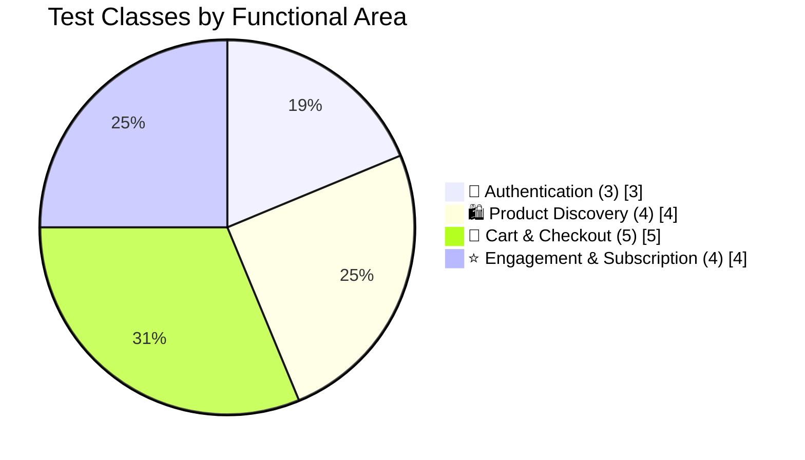
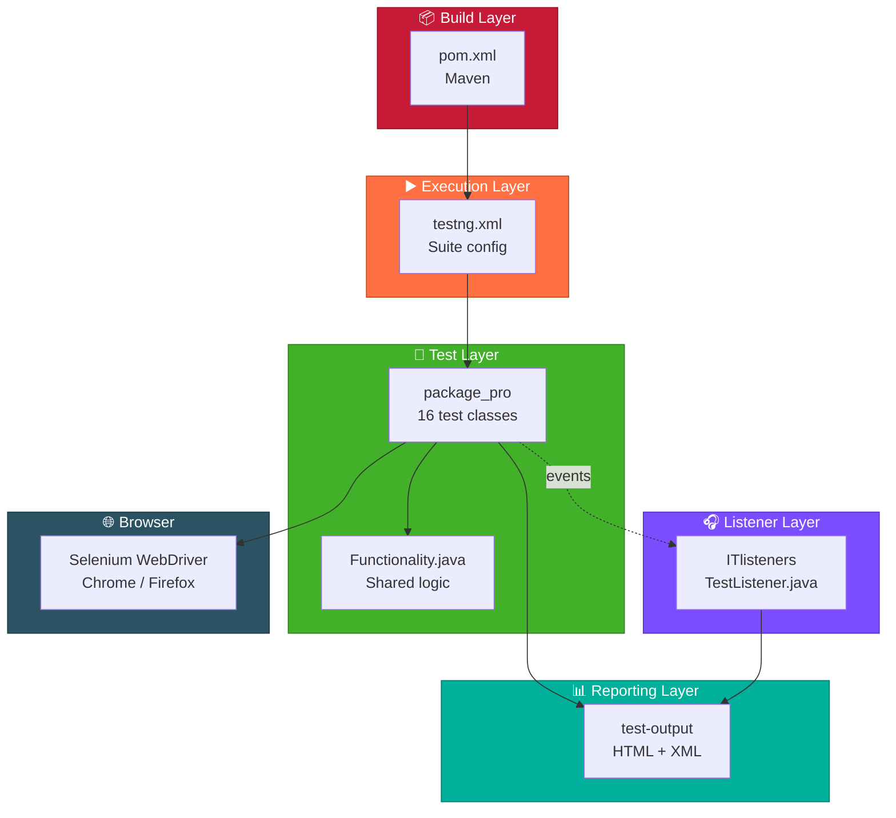
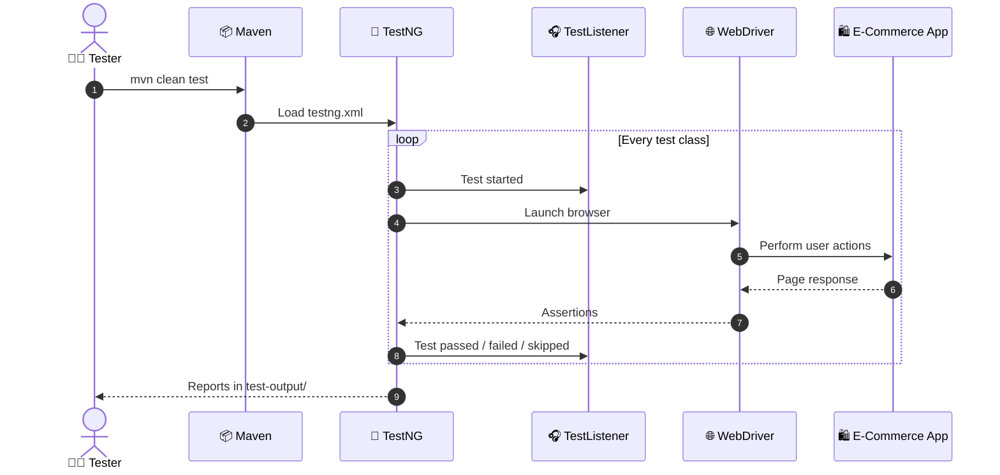
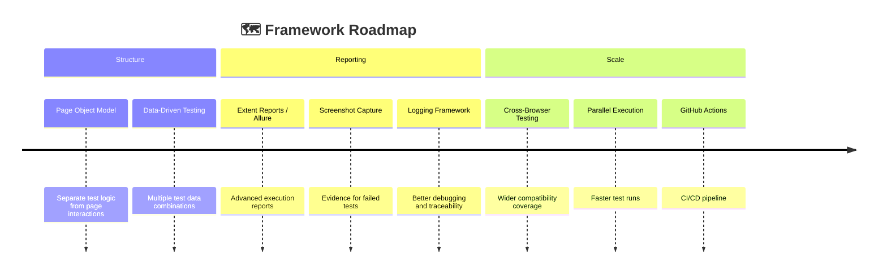

<div align="center">


<a href="https://github.com/jancirani-testing">
  
</a>

<br/>


<br/>

**[📌 Overview](#-project-overview)** •
**[✨ Features](#-key-features)** •
**[🧰 Tech Stack](#-technology-stack)** •
**[🧪 Coverage](#-test-coverage)** •
**[🏗️ Architecture](#%EF%B8%8F-project-architecture)** •
**[🚀 Installation](#-getting-started)** •
**[▶️ Execution](#%EF%B8%8F-test-execution)** •
**[📊 Reports](#-test-reports--results)**

</div>


## 📌 Project Overview

**E-Commerce Test Automation Framework** is a web UI automation project that verifies the **functionality, reliability, and usability** of an e-commerce application.

It automates real-world shopping scenarios and walks through the **complete customer journey**, from creating an account and discovering products to managing the cart and completing checkout.

Built with **Selenium WebDriver** and **TestNG**, the project demonstrates structured test organization, execution management, and reporting through a **custom TestNG listener**.

> 🎯 **Mission:** Catch defects early, validate critical user journeys, and build confidence in application quality through automation.

### 🗺️ The Customer Journey We Automate


---

## 🎯 Project Goals

| | Goal |
|:-:|:--|
| 🤖 | Automate repetitive manual testing activities |
| 🧭 | Validate critical e-commerce business workflows |
| 🎯 | Improve test execution consistency and reliability |
| 🧹 | Organize test scripts for readability and maintenance |
| 📈 | Generate execution reports for result analysis |
| 💡 | Demonstrate practical Selenium and TestNG skills |

---

## ✨ Key Features

<table>
<tr>
<td width="50%" valign="top">

### 🛒 End-to-End Shopping Tests
- 🔎 Product discovery and search
- ➕ Add and remove cart items
- 🔢 Product quantity validation
- 💳 Checkout and order placement
- 🌟 Recommended product verification

</td>
<td width="50%" valign="top">

### 🔐 Account & Authentication
- 📝 User registration
- 🔑 Login functionality
- 🚪 Logout functionality
- 📬 Subscription verification
- 👤 Account-related workflows

</td>
</tr>
<tr>
<td width="50%" valign="top">

### ⚙️ Automation Architecture
- 🌐 Selenium WebDriver integration
- 🧪 TestNG test execution
- 📦 Maven dependency management
- 🗂️ Organized Java test packages
- 🎧 Custom TestNG listener

</td>
<td width="50%" valign="top">

### 📊 Execution & Reporting
- ⚡ Automated test execution
- 🌐 TestNG HTML reports
- 📄 XML execution reports
- 🔄 Test lifecycle monitoring
- ✅ Execution result tracking

</td>
</tr>
</table>

---

## 🧰 Technology Stack

| Technology | Purpose |
|:--|:--|
| ☕ **Java 8+** | Programming language |
| 🌐 **Selenium WebDriver** | Browser automation |
| 🧪 **TestNG** | Test execution and management |
| 📦 **Apache Maven** | Build and dependency management |
| 🎧 **TestNG Listeners** | Test lifecycle monitoring |
| 💻 **Eclipse IDE** | Development environment |
| 🌍 **Chrome / Firefox** | Browser execution |

<details>
<summary><b>📚 Technology Resources (click to expand)</b></summary>
<br/>

- ☕ [Java Documentation](https://docs.oracle.com/en/java/)
- 🌐 [Selenium Documentation](https://www.selenium.dev/documentation/)
- 🧪 [TestNG Documentation](https://testng.org/doc/)
- 📦 [Apache Maven Guide](https://maven.apache.org/guides/)

</details>

---

## 🧪 Test Coverage

The suite spans **4 functional areas** with **16 test classes** plus shared framework components.



<details open>
<summary><b>🔐 1. Authentication & Account Management</b></summary>
<br/>

| Test Class | Testing Scenario |
|:--|:--|
| `Register.java` | ✅ Verify user registration |
| `Login.java` | ✅ Validate login functionality |
| `LogOut.java` | ✅ Verify logout functionality |

</details>

<details open>
<summary><b>🛍️ 2. Product Discovery & Navigation</b></summary>
<br/>

| Test Class | Testing Scenario |
|:--|:--|
| `Search_product.java` | 🔎 Search for products |
| `View_category.java` | 🗂️ Verify product categories |
| `Verify_all_product_page.java` | 📃 Validate product listing page |
| `Recommended_items.java` | 🌟 Verify recommended products |

</details>

<details open>
<summary><b>🛒 3. Shopping Cart & Checkout</b></summary>
<br/>

| Test Class | Testing Scenario |
|:--|:--|
| `Add_toCart.java` | ➕ Add products to shopping cart |
| `Remove_cart.java` | ➖ Remove products from cart |
| `ViewCartProduct.java` | 🧾 Verify cart product details |
| `Product_quantity.java` | 🔢 Validate product quantity |
| `Place_order_Resister_checkout.java` | 💳 Verify order placement and checkout |

</details>

<details open>
<summary><b>⭐ 4. User Engagement & Subscription</b></summary>
<br/>

| Test Class | Testing Scenario |
|:--|:--|
| `Review_on_product.java` | ✍️ Submit product reviews |
| `Contact_us.java` | 📞 Verify contact functionality |
| `Verify_Subscription.java` | 📬 Validate subscription functionality |
| `verify_subscription_cartPage.java` | 🛒 Verify subscription on cart page |

</details>

<details open>
<summary><b>⚙️ 5. Framework Components</b></summary>
<br/>

| Component | Responsibility |
|:--|:--|
| `TestListener.java` | 🎧 Monitor TestNG test lifecycle |
| `Functionality.java` | 🧰 Shared test functionality |

</details>

> 📝 **Note:** Test coverage is based on the test classes currently included in the project.

---

## 🏗️ Project Architecture

The project follows a structured **Maven directory layout** that separates application code, test scripts, resources, and execution reports.



<details>
<summary><b>📁 Full directory structure (click to expand)</b></summary>

```text
ecommerce-test-automation/
│
├── 📂 src/
│   │
│   ├── 📂 main/
│   │   └── 📂 java/
│   │       └── 📂 ITlisteners/
│   │           ├── 🎧 TestListener.java
│   │           └── 📄 package-info.java
│   │
│   └── 📂 test/
│       ├── 📂 java/
│       │   └── 📂 package_pro/
│       │       ├── ➕ Add_toCart.java
│       │       ├── 📞 Contact_us.java
│       │       ├── 🧰 Functionality.java
│       │       ├── 🚪 LogOut.java
│       │       ├── 🔑 Login.java
│       │       ├── 💳 Place_order_Resister_checkout.java
│       │       ├── 🔢 Product_quantity.java
│       │       ├── 🌟 Recommended_items.java
│       │       ├── 📝 Register.java
│       │       ├── ➖ Remove_cart.java
│       │       ├── ✍️ Review_on_product.java
│       │       ├── 🔎 Search_product.java
│       │       ├── 📬 Verify_Subscription.java
│       │       ├── 📃 Verify_all_product_page.java
│       │       ├── 🧾 ViewCartProduct.java
│       │       ├── 🗂️ View_category.java
│       │       ├── 🛒 verify_subscription_cartPage.java
│       │       └── 📄 package-info.java
│       │
│       └── 📂 resources/
│
├── 📊 test-output/              # Generated TestNG reports
├── 🎯 target/                   # Maven build output
├── 📦 pom.xml                   # Maven configuration
├── 🧪 testng.xml                # TestNG suite configuration
└── 📘 README.md                 # Project documentation
```

</details>

### 🔍 Architecture Highlights

| Layer | Description |
|:--|:--|
| 🧪 **Test Layer** | Individual Java test classes that validate application features |
| 🎧 **Listener Layer** | Handles TestNG lifecycle events through a custom listener |
| 🗃️ **Resource Layer** | A home for test data and configuration resources |
| 📦 **Build Layer** | Maven manages dependencies and build execution |
| 📊 **Reporting Layer** | TestNG generates execution reports after each run |

---

## 🚀 Getting Started

Follow these steps to set up and run the framework locally.

### 📋 Prerequisites

| Requirement | Version |
|:--|:--|
| ☕ Java JDK | 8 or above |
| 📦 Apache Maven | Compatible installed version |
| 💻 Eclipse IDE | Latest recommended |
| 🌍 Browser | Chrome / Firefox |
| 🔌 TestNG Plugin | For Eclipse execution |

### ⚡ Quick Setup

**1️⃣ Clone the repository**
```bash
git clone https://github.com/jancirani-testing/ecommerce-test-automation.git
```

**2️⃣ Navigate to the project**
```bash
cd ecommerce-test-automation
```

**3️⃣ Verify Java and Maven**
```bash
java -version
mvn -version
```

**4️⃣ Install project dependencies**
```bash
mvn clean install
```

**5️⃣ Import into Eclipse**

1. Open **Eclipse IDE**
2. Select **File → Import**
3. Choose **Existing Maven Projects**
4. Browse to the cloned repository
5. Select the project and click **Finish**
6. Right-click the project and select **Maven → Update Project**

---

## ▶️ Test Execution

Run the scripts from **Eclipse** or from the **Maven command line**.

<table>
<tr>
<td width="50%" valign="top">

### 💻 Option 1: Eclipse

1. Open the project in Eclipse
2. Locate `testng.xml`
3. Right-click the file
4. Select **Run As → TestNG Suite**
5. Watch results in the TestNG console

</td>
<td width="50%" valign="top">

### ⌨️ Option 2: Maven

```bash
# Run the configured suite
mvn test

# Clean build, then test
mvn clean test

# Build and package
mvn clean package
```

</td>
</tr>
</table>

> ⚠️ **Execution Note:** Test execution depends on the browser, application availability, and configuration used by the test scripts. Update the application URL, credentials, and browser settings before running where applicable.

### 🔄 What Happens During a Run



---

## 📊 Test Reports & Results

After execution, TestNG generates reports to help you analyze the outcome of each test.

```text
📁 test-output/
│
├── 🌐 index.html
├── 📧 emailable-report.html
├── 📄 testng-results.xml
└── 🗂️ other generated report files
```

| Report | Description |
|:--|:--|
| 🌐 `index.html` | TestNG execution summary |
| 📧 `emailable-report.html` | Email-friendly test execution report |
| 📄 `testng-results.xml` | Structured XML test results |

### 👀 View Your Results

1. ▶️ Execute the test suite
2. 📂 Open the `test-output/` directory
3. 🌐 Open `index.html` in your browser
4. ✅ Review **passed**, ❌ **failed**, and ⏭️ **skipped** tests

---

## 🔮 Future Enhancements



| Enhancement | Description | Status |
|:--|:--|:-:|
| 🧱 Page Object Model | Improve separation of test logic and page interactions |  |
| 📈 Extent Reports / Allure | Add advanced execution reporting |  |
| 🤖 GitHub Actions | Automate test execution through CI/CD |  |
| 🌍 Cross-Browser Testing | Expand browser compatibility coverage |  |
| ⚡ Parallel Execution | Reduce execution time |  |
| 🗃️ Data-Driven Testing | Support multiple test data combinations |  |
| 📸 Screenshot Capture | Capture screenshots for failed tests |  |
| 📝 Logging Framework | Improve debugging and execution traceability |  |

---

## 🤝 Contributing

Contributions, suggestions, and improvements are always welcome! 💚

```bash
# 1. Fork the repository, then create a branch
git checkout -b feature/your-feature-name

# 2. Commit your changes
git commit -m "Add: your feature description"

# 3. Push your branch
git push origin feature/your-feature-name
```

**4.** Open a **Pull Request** and describe your changes for review.

---

## 🐛 Issues & Feedback

Found a bug or have an idea to improve the framework?

- 🐞 Open an issue in the GitHub repository
- 📝 Describe the problem clearly
- 📎 Include relevant execution details or screenshots
- 💡 Suggest improvements whenever possible

Your feedback helps make the framework better!

---

## 👨‍💻 Author

<div align="center">


**QA Automation Tester** &nbsp;|&nbsp; ☕ Java &nbsp;|&nbsp; 🌐 Selenium WebDriver &nbsp;|&nbsp; 🧪 TestNG

*Passionate about software quality, test automation, and building reliable testing solutions.*

<a href="https://github.com/jancirani-testing">
  
</a>

<br/><br/>

**🧪 Building better software, one automated test at a time.**

</div>

---

## 📄 License

This project is distributed under the **MIT License**. See the [LICENSE](LICENSE) file for more information.

---

<div align="center">

## ⭐ Like This Project?

If you find this automation framework useful, consider giving it a **Star ⭐** on GitHub.
Your support and feedback are appreciated!

<br/>


**Made with ☕ Java, 🧪 Selenium & ❤️ for Quality Assurance**

</div>
